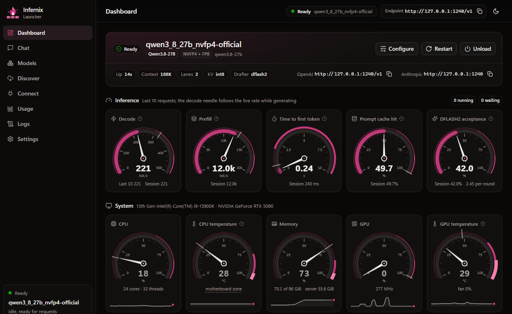

<h1 align="center">
  <picture>
    <source media="(prefers-color-scheme: dark)" srcset="docs/assets/infernix-logo-dark.svg">
    
  </picture>
</h1>

> **AI disclaimer:** everything added since the fork from NInfer, including most of this README, was
> written with AI (mostly Claude Opus 5.5 and Qwen3.8-27B running on Infernix). It is likely to be
> neither complete nor entirely accurate. This is hobby development.

Infernix is a C++/CUDA inference engine that serves Qwen models on one NVIDIA RTX 5090. It began as a fork of [NInfer](https://github.com/Neroued/ninfer) by
[Neroued](https://github.com/Neroued) and reads NInfer's `.ninfer` artifacts as well as its own
`.infernix` files.

## Headline results

One RTX 5090 on PCIe Gen5 x8, 2026-10-30/31. Every engine ran its latest version at the time,
natively on Windows, with its own recommended settings and drafter and the same 84 GiB RAM budget.
**Context**: one request, ~8K to ~250K tokens. **Replay**: an agentic coding workload, two requests
at a time. Full tables and methods: [Benchmarks](#benchmarks).

**Speed without precision shortcuts.** Infernix keeps every activation at the precision the
checkpoint specifies (16 bits where the others round to 8), runs every routed expert (no expert tail
skipping) and computes the full output head (no 2-bit screen). Basalt, which computes with fewer
bits (6-bit dense layers on NVFP4; on IQ3_S 8-bit activations, an 8-bit copy of the hyper-connection
matrices and a 2-bit head screen), has the highest decode tok/s at Infernix's defaults. On NVIDIA's
NVFP4 weights Infernix still reaches the first token 5-8× sooner and finishes the agentic workload
36 % sooner, and with its experts at 8 bits as Basalt runs them it matches or passes Basalt's decode
too. On the IQ3_S GGUF Basalt is ahead overall (4.4 against 5.5 min); with the same 8-bit
activations Infernix matches its first tokens, but Basalt still decodes faster. Measured quality for
every engine follows in a later update.

| Infernix vs | First token | Decode | Replay: mean first token | Replay: wall time |
|---|---|---|---|---|
| **Qwen3.8-Flash-Next, NVIDIA's NVFP4 weights** | | | | |
| [Strata](https://github.com/Niko1221/Strata) v0.2.8 | 1.4-1.6× sooner | +10-15 % to 128K, −4 % at 250K | 3.1 s vs 12.3 s | 5.7 vs 12.9 min |
| [strata-nvfp4](https://github.com/sergqwer/strata-nvfp4) 0.2.0-beta-nvfp4.3 | 1.3× sooner | level to +3 % | 3.1 s vs 10.8 s | 5.7 vs 11.7 min |
| [Basalt](https://github.com/jesdga95/basalt) `c08284cb` | 5-8× sooner¹ | Basalt 7-23 % faster² | 3.1 s vs 7.2 s | 5.7 vs 8.9 min |
| **Qwen3.8-Flash-Next, ISTA-DASLab's IQ3_S GGUF** | | | | |
| Strata v0.2.8³ | 15 % sooner at 8K, level from 128K | +3-12 % | 3.1 s vs 6.9 s | 5.5 vs 8.1 min |
| Basalt `c08284cb` | Basalt 4 % sooner at 8K, 1.3× from 128K⁴ | Basalt 1.4-1.7× faster⁴ | 3.1 s vs 3.7 s | Basalt sooner: 4.4 vs 5.5 min⁴ |
| **Qwen3.8-27B, the same NVFP4 artifact in both** | | | | |
| [NInfer](https://github.com/Neroued/ninfer) `1882c6adb` | 9 % sooner at 8K, 1.6-1.8× from 128K | +11-17 % (own drafters), +2-3 % without | 1.9 s vs 2.5 s | 12.7 vs 16.4 min |

1. Basalt reads its 50.7 GiB n-gram table from the SSD here: it does not fit in the RAM budget beside
   its experts.
2. Basalt runs NVIDIA's BF16 dense layers at **6 bits** (+10 % KL divergence by its own measure) and
   every activation outside the experts at **8 bits**; Infernix keeps 16. With the experts at 8 bits
   as Basalt runs them in decode (`--a8-activations`), Infernix decodes 199 / 185 / 268 tok/s
   against Basalt's 202 / 173 / 216 at ~8K / ~128K / ~250K and 175 against 166 at one request in the
   replay, and still reaches the first token 4-6× sooner.
3. Strata's default route tail skip (it skips some missed experts) was off: it changes which experts
   run.
4. All three hold the GGUF's weights as published, but Strata and Basalt compute **every activation
   at 8 bits**, and Basalt's decode reads the BF16 hyper-connection matrices from an **8-bit copy**
   and takes the logits outside the top 64 from a **2-bit copy** of the output head; Infernix keeps
   16-bit activations, the BF16 matrices and the GGUF's head. At 8 bits (`--a8-activations`) Infernix
   reaches the first token as soon as Basalt, which still decodes 1.2-1.7× as fast.

### Activation precision

Infernix computes each model at the activation precision its checkpoint specifies; options change
it:

| Weights | Default | Options |
|---|---|---|
| NVIDIA NVFP4 Flash-Next (Dense8 and the bit-exact conversion) | Routed experts **4-bit** (W4A4 with NVIDIA's calibrated scales), because NVIDIA's checkpoint specifies it; everything else 16-bit | `--a8-activations`: experts 8-bit. `--a16-activations`: experts 16-bit on the stored 4-bit weights |
| NVIDIA FP4-Local Flash-Next | 16-bit, as NVIDIA serves it | `--expert-a4-activations`: experts 4-bit. `--a8-activations`: experts 8-bit |
| Uncensored NVFP4 Flash-Next | 16-bit (weight-only NVFP4 experts) | `--a8-activations`: experts 8-bit |
| IQ3_S GGUF Flash-Next | 16-bit everywhere | `--a8-activations`: dense projections and experts 8-bit, as Strata and Basalt |
| Qwen3.8-27B NVFP4 | 4-bit at its NVFP4 layers, as the artifact specifies (NInfer the same) | none |

On NVIDIA's NVFP4 weights Strata, strata-nvfp4 and Basalt run the experts at 8 bits in decode and
every other activation at 8 bits. The options on Dense8 (RTX 5090, one request):

| Experts' activations | First token at ~8K / ~128K / ~250K | Decode rounds a second | Agentic replay |
|---|---|---|---|
| 4-bit (default) | 1.9 / 12.2 / 23.9 s | | 5.7 min |
| 8-bit, `--a8-activations` | level / 28 % / 28 % later | 1-7 % more | decode 6 % faster, uncached prompts 16 % slower: 5.7 min |
| 16-bit, `--a16-activations` | level / 38 % / 37 % later | 2-6 % more | not run |

Only the 4-bit route reads prompts on the RTX 5090's FP4 tensor cores, which makes it the fastest
for agents. Both options change the output; their quality is not measured yet.

## Why Infernix

### Qwen3.8-Flash-Next on one RTX 5090

The 24,576 routed experts (63 GiB at NVFP4) live in pinned RAM, the hot ones cached in VRAM; each
layer's misses are split between the CPU and the PCIe link, and the 52 GB n-gram table is read from
NVMe.

- **Soonest first token** on NVIDIA's NVFP4 weights: 1.3-1.6× sooner than Strata and strata-nvfp4
  from 8K to 250K tokens; 36-56 % less wall time than every other engine in an agentic replay
  ([benchmarks](#qwen38-flash-next-nvfp4-infernix-vs-strata-strata-nvfp4-and-basalt)).
- **Activations as the checkpoint specifies**: 16-bit wherever it keeps BF16 (all of them on GGUF),
  where Strata and Basalt use 8 bits ([activation precision](#activation-precision)).
- **DFlash2 drafting** with Inco AI's drafter
  ([Qwen3.8-Flash-Next-DFlash2-Infernix](https://huggingface.co/Wallawalla47/Qwen3.8-Flash-Next-DFlash2-Infernix),
  776 MB, any conversion): 8-11 % faster than MTP, 26 % on sampled code
  ([benchmarks](#qwen38-flash-next-dflash2-against-mtp)).
- **Long context**: 262K tokens natively, 1M with YaRN; a 250K prompt prefills in about 24 s.
- **Less RAM than the model?** An SSD expert tier reads what does not fit.
- **Uncensored too**:
  [Qwen3.8-Flash-Next-Uncensored-NVFP4-Infernix](https://huggingface.co/Wallawalla47/Qwen3.8-Flash-Next-Uncensored-NVFP4-Infernix)
  keeps orcarouter's abliterated NVFP4 experts and FP8 projections bit-exact (perplexity 4.772).

Setup and tuning: the [Qwen3.8-Flash-Next guide](docs/qwen3_8-flash-next.md).

### Qwen3.8-27B: faster prefill and decode

Against NInfer on the same artifact ([benchmarks](#qwen38-27b-infernix-vs-ninfer)):

- **Hybrid prefix cache** for Qwen's linear-attention layers (64-token KV blocks, recurrent-state
  snapshots, GPU, RAM and file tiers): in an agentic replay the median first token comes 36 %
  sooner and the work finishes 21 % sooner.
- **Faster prefill**: 1.6-1.8× NInfer's on long prompts.
- **Faster decode**: DFlash2 with n-gram copy drafts, 11-17 % ahead of NInfer's MTP; draft trees
  (`--draft-tree-nodes`) are an option on top.
- **Smaller KV**: `k4v2` and `vq2` hold 2.7 and 4 times the context of INT8.

### Built for agents

- **APIs**: OpenAI Chat Completions and Responses, Anthropic Messages and streaming, with the options
  Claude Code, Qwen Code, Codex, Zed and GitHub Copilot send.
- **Tool calling**: the XML forms agents emit, recovery of broken calls (`--tolerant-tool-calls`),
  and deferred tools (`defer_loading`, regex/BM25 tool search, `tool_reference`) that keep large MCP
  catalogs out of the prompt.
- **Constrained decoding**: JSON object and Schema, strict tool arguments, GBNF, regex and choice
  grammars, with every model and drafter.
- **Thinking control**: budgets with a wrap-up message, effort levels and a repetition guard
  (`--reasoning-loop`).
- **Concurrency and resilience**: one to eight requests with preemption under memory pressure; the
  prefix cache persists across restarts; a failed Flash-Next expert read fails only the requests
  running then.
- **`/v1/decide`**: decisions from token probabilities (yes/no, choice, score, number, scalar, point
  and box).

### And also

- **Speculative decoding**: MTP, DFlash, DFlash2 and n-gram drafting with exact sampling, on by
  default with the drafter measured fastest for each model (`--spec auto`).
- **KV formats**: `int8`, `bf16`, `fp8`, `nvfp4`, `k8v4`, `vq2` and `k4v2`.
- **Vision**: images and video; the vision encoder can stay in system RAM.
- **Conversion**: Hugging Face, NVIDIA ModelOpt, Quasar and GGUF sources; Q4-Q8, FP8, NVFP4 and
  mixed recipes.
- **Windows and Linux**: native MSVC and GCC builds, WSL2 included.

## Benchmarks

RTX 5090 (32 GB) on **PCIe Gen5 x8**, Core i9-13900K, 96 GB DDR5, Windows 11; Gen5 x16 reads
Flash-Next's prompts up to twice as fast ([measured](#pcie-gen5-x8-against-x16)). TTFT: time to the
first token; bold: best in its row. Methods and every engine's settings are at the end of each
section and [below](#how-the-benchmarks-were-run).

### Qwen3.8-Flash-Next NVFP4: Infernix vs Strata, strata-nvfp4 and Basalt

Infernix runs the [Dense8 conversion](#models) of NVIDIA's checkpoint with Inco AI's DFlash2 drafter;
the others run NVIDIA's checkpoint as their own NVFP4 packs with the model's MTP drafter.

**Context length** (one request):

| Context | TTFT: Infernix | Strata | strata-nvfp4 | Basalt | Decode tok/s: Infernix | Strata | strata-nvfp4 | Basalt |
|---|---:|---:|---:|---:|---:|---:|---:|---:|
| ~8K | **1.88 s** | 2.67 s | 2.48 s | 9.55 s | 183 | 159 | 177 | **202** |
| ~128K | **12.22 s** | 18.83 s | 15.34 s | 92.94 s | 161 | 146 | 161 | **173** |
| ~250K | **23.90 s** | 37.55 s | 31.78 s | 125.92 s | 175 | 183 | 172 | **216** |

**Agentic replay** (two requests at a time, three seeds):

| Metric | Strata | strata-nvfp4 | Basalt | Infernix | Infernix 8-bit experts† | Infernix vs Strata | vs strata-nvfp4 | vs Basalt |
|---|---:|---:|---:|---:|---:|---:|---:|---:|
| Mean TTFT | 12.3 s (10.8-13.9) | 10.8 s (9.2-12.0) | 7.2 s (6.4-7.9) | **3.1 s** (2.9-3.5) | 3.4 s (3.3-3.6) | −74 % | −71 % | −56 % |
| Median TTFT | 9.92 s | 7.62 s | 3.81 s | **2.04 s** | 2.00 s | −79 % | −73 % | −46 % |
| 90th-percentile TTFT | 25.9 s | 24.7 s | 17.5 s | **7.1 s** | 8.6 s | −71 % | −71 % | −59 % |
| Mean TTFT, new long prompts | 11.8 s | 10.2 s | 20.8 s | **6.1 s** | 7.4 s | −48 % | −38 % | −70 % |
| Prompt tokens from cache | 46.1 % | 53.2 % | 83.1 % | **84.5 %** | 84.5 % | +38.4 pt | +31.2 pt | +1.4 pt |
| Prefill tok/s, no cache hit | 5,170 | 5,847 | 2,349 | **7,480-7,689** | 6,216-6,281 | +45 % | +30 % | 3.3× |
| Output tok/s, one request | 116 (114-120) | 110 (108-113) | **166** (160-170) | **166** (165-169) | 175 (170-179) | +43 % | +51 % | level |
| Output tok/s, batched | 67 | 69 | 129 | **149** (142-157) | 158 (147-171) | 2.2× | 2.2× | +15 % |
| Tokens per round | 2.26 | 2.21 | 2.37 | **2.61** | 2.63 | +15 % | +19 % | +11 % |
| Wall time | 12.9 min (12.0-13.8) | 11.7 min (11.0-12.9) | 8.9 min (8.6-9.1) | **5.7 min** (5.4-5.9) | 5.7 min (5.6-5.8) | −56 % | −51 % | −36 % |

Bold and the comparison columns are the engines' defaults. † `--a8-activations`: the routed experts at
8 bits, as the others run them in decode (every other activation stays 16-bit); same three seeds,
on the build that added this route (`81bcdaef`). Against Basalt it reaches the first token 52 %
sooner on average, decodes 5 % faster at one request and 22 % faster batched, and finishes 35 %
sooner.

- **First tokens**: the prefix cache reuses what the others re-read (whole prompts re-prefilled on
  continuing turns per seed: Strata 15-17 of 41, strata-nvfp4 9-14, Basalt 0-1, Infernix 1).
  Basalt's are slow here because it reads its n-gram table from the SSD (its own A/B on IQ3_S: 5×
  slower at 128K).
- **Decode**: Basalt is 7-23 % faster on one request, with coarser arithmetic (below); in the replay
  it is level at one request and Infernix leads by 15 % at two. At ~250K each request's thinking
  decides how many drafts are accepted (per request: Infernix 160-195 tok/s, Basalt 190-242).

**What each engine computes** (not switchable unless noted):

| | Infernix | Strata v0.2.8 | strata-nvfp4 | Basalt |
|---|---|---|---|---|
| Routed experts' activations (4-bit in the checkpoint) | 4-bit with NVIDIA's calibrated scales, as the checkpoint specifies (8 or 16 by option) | 8-bit | 8-bit; in the prompt, gate/up two 4-bit terms per value | 8-bit; prompt chunks of 1,024+ tokens 4-bit |
| Other activations (BF16 in the checkpoint) | 16-bit | **8-bit** | **8-bit** | **8-bit** |
| Dense layers (BF16 in the checkpoint) | 8-bit (Dense8; the bit-exact conversion keeps BF16) | 8-bit | 8-bit | **6-bit** (+10 % KL divergence by Basalt's measure) |
| n-gram table (FP8 in the checkpoint) | FP8 | FP8 | FP8 | re-blocked to 8-bit |

None of these engines has a lossy default that could be turned off. Measured quality (KL divergence
against an exact reference) follows in a later update.

**Context length with 8-bit expert activations** (`--a8-activations`, closer to the others'
arithmetic in decode):

| | TTFT ~8K / ~128K / ~250K | Decode tok/s |
|---|---:|---:|
| Infernix, 4-bit experts (default) | 1.88 / 12.22 / 23.90 s | 183 / 161 / 175 |
| Infernix `--a8-activations` | 1.88 / 15.53 / 30.58 s | 199 / 185 / 268 |
| Basalt (as above) | 9.55 / 92.94 / 125.92 s | 202 / 173 / 216 |

With its experts at 8 bits Infernix decodes level with Basalt at ~8K and faster at ~128K and ~250K.
Against its own session's default (on `81bcdaef`'s build) the 8-bit route runs 1-7 % more decode
rounds a second (tok/s rises 9-36 %, partly from different text and drafts) but reads long prompts
28 % slower, so the default stays the faster choice for agents.

*Settings*: Infernix `--spec dflash2`, draft length auto, `--lm-head-draft`, `--vram-past-budget`.
Strata: its setup's configuration for this PC plus its `--prefill auto:32768` tip for 96 GB PCs.
strata-nvfp4: its bundled `--spec 6 --spec-min-p 0.7`. Basalt: its NVFP4 pack, MTP windows of 8,
n-gram table on the SSD (in RAM it pushed 28 % of the experts out and the first request failed).
Basalt loads its model during its first request; every session starts with an uncounted warm-up.

### Qwen3.8-Flash-Next IQ3_S: Infernix vs Strata and Basalt

All three run ISTA-DASLab's GSQ-RCO `IQ3_S` GGUF: Infernix its [bit-exact conversion](#models) with
the DFlash2 drafter, Strata* the GGUF, Basalt its IQ3_S pack.

**Context length** (one request):

| Context | TTFT: Infernix | Strata* | Basalt | Decode tok/s: Infernix | Strata* | Basalt |
|---|---:|---:|---:|---:|---:|---:|
| ~8K | 1.40 s | 1.65 s | **1.35 s** | 229 | 209 | **380** |
| ~128K | 18.10 s | 17.97 s | **13.47 s** | 201 | 196 | **298** |
| ~250K | 35.59 s | 36.56 s | **27.98 s** | 250 | 223 | **339** |

**Agentic replay** (two requests at a time, three seeds):

| Metric | Strata* | Basalt | Infernix | vs Strata* | vs Basalt |
|---|---:|---:|---:|---:|---:|
| Mean TTFT | 6.9 s (6.1-7.5) | 3.7 s (3.2-4.2) | **3.1 s** (2.9-3.4) | −55 % | −14 % |
| Median TTFT | 4.49 s | 1.97 s | **1.48 s** | −67 % | −24 % |
| 90th-percentile TTFT | 15.4 s | 9.5 s | **9.2 s** | −39 % | +2 % |
| Mean TTFT, new long prompts | 9.3 s | **8.4 s** | 9.4 s | +2 % | +12 % |
| Prompt tokens from cache | 72.9 % | **83.2 %** | 82.6 % | +9.8 pt | −0.6 pt |
| Prefill tok/s, no cache hit | 6,298 | **7,714** | 5,860-5,968 | −7 % | −22 % |
| Output tok/s, one request | 159 (157-161) | **296** (292-298) | 201 (198-203) | +26 % | −32 % |
| Output tok/s, batched | 111 | **249** | 184 (171-202) | +66 % | −26 % |
| Tokens per round | 2.17 | 2.48 | **2.64** | +22 % | +7 % |
| Wall time | 8.1 min (7.7-8.5) | **4.4 min** (4.2-4.6) | 5.5 min (5.1-6.2) | −32 % | +26 % |

Infernix beats Strata on decode and wall time and reaches the first token soonest on short
continuing turns. Basalt decodes about 1.5× as fast and finishes 26 % sooner. All three hold the
GGUF's weights as published (Basalt's pack copies them byte for byte); the differences are in what
they compute:

| | Infernix | Strata* v0.2.8 | Basalt |
|---|---|---|---|
| Activations in matrix multiplies | 16-bit (8 by option) | **8-bit** | **8-bit** |
| Hyper-connection matrices (BF16 in the GGUF) | BF16 | BF16 (8-bit by option) | **8-bit copy** in decode |
| Experts that run | every routed expert | every routed expert (route tail skip **off**) | every routed expert |
| Output head | the GGUF's | the GGUF's | logits outside the top 64 from a **2-bit copy** (the choices themselves exact; +1.1 % KL divergence by Basalt's measure) |

\* Strata's default for this weight set skips a missed expert that every token of a verify window
ranks 7th or lower: faster, but different answers. It was off (`STRATA_ROUTE_TAIL_SKIP=0`) because it
changes which experts run. The 8-bit activations of Strata and Basalt cannot be turned off.

**Infernix with 8-bit activations** (`--a8-activations`, the others' arithmetic; an option, not the
comparison above):

| | TTFT ~8K / ~128K / ~250K | Decode tok/s | Replay: mean TTFT | Replay: output tok/s | Replay: wall time |
|---|---:|---:|---:|---:|---:|
| Infernix (16-bit, default) | 1.40 / 18.10 / 35.59 s | 229 / 201 / 250 | 3.1 s | 201 | 5.5 min |
| Infernix `--a8-activations` | 1.30 / 13.99 / 27.68 s | 224 / 211 / 278 | 2.9 s | 208 | 5.2 min |
| Basalt (as above) | 1.35 / 13.47 / 27.98 s | 380 / 298 / 339 | 3.7 s | 296 | 4.4 min |

At the same 8 bits Infernix reads prompts as fast as Basalt; Basalt still decodes 1.2-1.7× as fast.

*Settings*: Infernix as on NVFP4, its IQ4_NL n-gram table on the SSD (in RAM it would displace 6.2
GiB of experts: 4 % sooner to the first token, 3-7 % slower decode). Strata: its setup's
`--spec 4 --spec-min-p 0.5 --pool-workers 15`, every expert in RAM, `--prefill auto:32768`. Basalt:
n-gram table in RAM.

### Qwen3.8-Flash-Next: DFlash2 against MTP

Decode tok/s at one request (repeats within 4 %; Dense8 code: DFlash2 209-217, MTP 186-203):

| Conversion | Text | Plain | MTP | **DFlash2** | DFlash2 vs MTP |
|---|---|---:|---:|---:|---:|
| NVIDIA Dense8 | code, greedy | 120 | 198 | **213** | +8 % |
| NVIDIA Dense8 | code, sampled | | 162 | **204** | +26 % |
| NVIDIA Dense8 | docs, greedy | 121 | 164 | **179** | +9 % |
| NVIDIA Dense8 | docs, sampled | 122 | 145 | **161** | +11 % |
| GSQ-RCO IQ3_S | code, greedy | 121 | 233 | **258** | +11 % |
| GSQ-RCO IQ3_S | docs, greedy | | 192 | **210** | +9 % |
| GSQ-RCO IQ3_S | docs, sampled | | 167 | **183** | +10 % |

DFlash2 drafts seven tokens in one pass with a probability for each, and `auto` verifies only those
worth their cost in expert misses. It also leaves VRAM for more cached experts (Dense8 9,070 against
MTP's 8,740; IQ3_S 12,432 against 12,288). Greedy output is the same with either drafter; sampling
keeps its distribution.

*Settings*: both `--draft-tokens auto --lm-head-draft`, with `--spec mtp` or `--spec dflash2
--draft-model FILE`. 24 prompts of 1,280 tokens from Infernix's sources (code) and Markdown docs at
`e59fa1c7`, each continued for 384 tokens, greedy or sampled (temperature 1.0, top-k 20, top-p 0.95);
INT8 KV; `infernix_decode_quality_gen` (2026-10-20).

### Qwen3.8-27B: Infernix vs NInfer

Both serve NInfer's [Qwen3.8-27B-nvfp4-NInfer](https://huggingface.co/neroued/Qwen3.8-27B-nvfp4-NInfer),
so both compute the same arithmetic (4-bit activations at its NVFP4 layers, as the artifact
specifies), each with its own recommended drafter.

**Context length** (one request):

| Context | TTFT: Infernix | NInfer | Drafting tok/s: Infernix | NInfer | No drafting tok/s: Infernix | NInfer |
|---|---:|---:|---:|---:|---:|---:|
| ~8K | **0.65 s** | 0.71 s | **228** | 195 | **81.1** | 79.2 |
| ~128K | **18.61 s** | 29.88 s | **210** | 182 | **68.4** | 66.5 |
| ~230K | **47.04 s** | 84.43 s | **187** | 169 | **60.3** | 58.7 |

**Agentic replay** (two requests at a time, five seeds):

| Metric | NInfer | Infernix | vs NInfer |
|---|---:|---:|---:|
| Mean TTFT | 2.5 s (2.2-2.8) | **1.9 s** (1.6-2.2) | −21 % |
| Median TTFT | 0.93 s (0.85-1.13) | **0.59 s** (0.55-0.62) | −36 % |
| 90th-percentile TTFT | 6.6 s (5.1-8.2) | **5.3 s** (4.1-6.9) | −17 % |
| Mean TTFT, continuing turns | 2.12 s (1.88-2.52) | **1.67 s** (1.30-1.96) | −21 % |
| Mean TTFT, new long prompts | 10.9 s (10.6-11.2) | **7.5 s** (7.4-7.6) | −32 % |
| Prompt tokens from cache | 90.9 % (90.7-91.1) | 91.1 % (91.0-91.3) | +0.2 pt |
| Prefill tok/s, no cache hit | 4,749 | **7,088** | +49 % |
| Output tok/s, one request | 160 (154-164) | **220** (206-238) | +37 % |
| Output tok/s, batched | 193 (188-195) | **255** (245-262) | +32 % |
| Tokens per round | 2.68 | **3.68** | +38 % |
| Wall time | 16.4 min (14.0-19.0) | **12.7 min** (11.7-13.6) | −21 % |

Both decode the same rounds a second (59.8 against 59.9): Infernix's output lead is its drafter (3.5-4.9
tokens a round against 2.9-3.4). Quality is level: perplexity 4.468 against NInfer's 4.479 on the
1.04M-token corpus (16K context, INT8 KV; NInfer `81c8ce09`, 2026-10-19).

*Settings*: INT8 KV, 240,000 tokens, two lanes. NInfer `master` at
[`1882c6adb`](https://github.com/Neroued/ninfer/commit/1882c6adb) (2026-10-29) with a Windows port
(Win32 I/O, an IOCP read queue, MSVC fixes; greedy text identical to the previous port's on four
prompts), run as its RTX 5090 example: MTP 3 with the optimized proposal head, automatic capacity,
256 MiB headroom, 1,024-token prefill chunks. Infernix: DFlash2, draft length auto, the proposal
head and n-gram drafts. Neither caps thinking, so wall times are not comparable with earlier
versions of this table.

### PCIe Gen5 x8 against x16

Measured by [siganos](https://github.com/Wallawalla47/Infernix/issues/45) with only the link width
changed. Prompts gain the most; decode only 2-7 %.

| Workload | Requests | x8 | x16 | x16 / x8 |
|---|---:|---:|---:|---:|
| Decode (`tg512`), plain | 1 | 112.8 | 115.2 | 1.02× |
| Decode, MTP 4 drafts, `--lm-head-draft` | 1 | 158.9 | 170.1 | 1.07× |
| Decode, DFlash2 `auto`, `--lm-head-draft` | 1 | 225.9 | 230.1 | 1.02× |
| Decode, plain | 2 | 91.4 | 95.8 | 1.05× |
| Decode, DFlash2 `auto` (difference within noise) | 2 | 111.8 | 119.2 | 1.07× |
| Prompt (`pp4096`), `--prefill-chunk 4096` | 1 | 2,426 | 4,277 | 1.76× |
| Prompt, `--prefill-chunk 1024` | 1 | 2,170 | 4,319 | 1.99× |
| Host-to-device copy | | 28.9 GB/s | 57.8 GB/s | 2.00× |

*Setup*: RTX 5090, Ryzen 9 7950X, 94 GiB DDR5, Linux, Infernix `d8e52a85`, Qwen3.8-Flash-Next NVIDIA
NVFP4 Dense8, INT8 KV, `infernix_bench` (means of 3-5 runs, tok/s per request).

### How the benchmarks were run

- **Versions**: Infernix `main` built from source at
  [`fb491903`](https://github.com/Wallawalla47/Infernix/commit/fb491903) for the default route on
  NVIDIA's NVFP4 weights, and at [`6b066a54`](https://github.com/Wallawalla47/Infernix/commit/6b066a54)
  for IQ3_S, the 27B and the `--a8-activations` rows (on Dense8 with
  [`81bcdaef`](https://github.com/Wallawalla47/Infernix/commit/81bcdaef)'s 8-bit expert route added).
  Later builds were not re-measured. On `6b066a54` the NVFP4 default was within run-to-run spread
  (decode 178 / 168 / 195 tok/s; replay 3.3 s mean TTFT, 5.7 min). The other engines were each the
  latest version when they ran; Strata has since released v0.2.9 and Basalt has moved past `c08284cb`.
- **Client**: every engine served the OpenAI API natively on Windows to the same client, which times
  the first token from sending the request to the first streamed token (GPU power limit 517.5 W,
  clocks checked before every session).
- **Context length**: greedy, 1,024 output tokens; three ~8K prompts and two each of ~128K and
  ~250K (~230K on the 27B). Two Infernix sessions bracket the others' one each (pooled).
- **Agentic replay** ([`bench/agentic_ab`](bench/agentic_ab/README.md)): three coding-agent sessions
  and eleven subagents with tool calls, compactions, retries and aborts, up to eight requests in
  flight, temperature 1.0, 68 requests per seed; every engine replays the same observations two
  requests at a time and completed every request. Cells are means over seeds (range in brackets);
  comparison columns the mean of per-seed differences. The prefill row covers the prompts every run
  prefilled cold, a set that moves with each run's cache.
- **Rules for every engine**: its own recommended configuration for this PC and its own drafter;
  INT8 KV; 262,144 tokens on Flash-Next; an 8 GiB conversation or prefix cache; an 84 GiB RAM budget
  of the 96 (a server above it is stopped; none was); n-gram tables on the same kind of drive
  (Samsung 990 PRO); no thinking caps; every draft verified; and every switchable option that
  computes below the checkpoint's precision or changes which experts run turned off (* where that
  differs from the default).

## Infernix Launcher (beta)

> **Beta:** the launcher is new and still changing. Please report problems as
> [issues](https://github.com/Wallawalla47/Infernix/issues).

<p align="center">
  
</p>

`infernix-launcher` puts a web interface and one API endpoint in front of `infernix-serve`, so models
run without command lines:

- **Models**: finds the `.infernix` and `.ninfer` models, DFlash2 drafters and n-gram volumes on your
  drives, and downloads the published ones (resumable, checksummed).
- **Configurations**: each model starts from its recommended settings; change any option, keep
  several named configurations, and check whether one fits your GPU and RAM before loading it.
- **One endpoint for every model**: coding tools connect once (OpenAI-compatible `/v1`,
  Anthropic-compatible `/v1/messages`) and see every model; the launcher loads whichever one a
  request names. **Connect** has settings for Claude Code, Codex, Zed, Qwen Code and Hermes.
- **Watching it run**: live gauges for decode and prefill speed, cache hits and system load, the
  server's console, an event log, token usage by model and client, and a chat with image input.
- **Watchdog**: restarts a server that crashes or locks up, and explains a load that does not fit,
  with suggested changes.

To use it, build as in the quick start below and run `infernix-launcher.exe` from the folder of
`infernix-serve.exe`: it opens `http://127.0.0.1:1234` in your browser. Add your model folders (or
download a model) under **Models**, press **Load**, and point your tools at the addresses on
**Connect**. Settings and configurations persist in `infernix-launcher.json` beside the launcher. The
[launcher guide](docs/launcher.md) covers everything else.

## Quick start (Windows)

Prerequisites: Visual Studio 2026 (or 2022, MSVC 14.44) with its C++ CMake tools (they bring Ninja),
the CUDA 13.4 toolkit or later (CMake warns about an older one), and FFmpeg, libjpeg-turbo and curl from vcpkg (`x64-windows`, at `C:\vcpkg`;
`vcpkg install libjpeg-turbo:x64-windows` adds libjpeg-turbo to an existing tree); adjust the paths at
the top of `build_native.bat`. It builds with Ninja Multi-Config (about 30 % faster than the Visual
Studio generator); a `build-windows` tree from the Visual Studio generator is configured afresh on its
next build.

```bat
build_native.bat configure
build_native.bat build
```

The server is `build-windows\apps\Release\infernix-serve.exe`, with its DLLs beside it.

**The easy way: the launcher.** Run `infernix-launcher.exe`, beside the server: see
[Infernix Launcher](#infernix-launcher-beta).

To run the server directly instead, Qwen3.8-Flash-Next ([guide](docs/qwen3_8-flash-next.md#run)):

```bat
infernix-serve.exe Qwen3.8-Flash-Next-NVIDIA-NVFP4-Dense8-Infernix-00001-of-00003.infernix --ngram-volume Qwen3.8-Flash-Next-NVIDIA-NVFP4-Infernix.ngram --kv-dtype int8 --max-context 262144 --spec dflash2 --draft-model Qwen3.8-Flash-Next-DFlash2-Infernix.infernix --draft-tokens auto --lm-head-draft --max-concurrency 2 --vram-past-budget
```

The drafter is [Qwen3.8-Flash-Next-DFlash2-Infernix](https://huggingface.co/Wallawalla47/Qwen3.8-Flash-Next-DFlash2-Infernix);
without it, `--spec mtp --draft-tokens auto --lm-head-draft` uses the model's own MTP drafter, about
10 % slower (builds from 2026-10-31 choose between the two by themselves, see below).
`--vram-past-budget` (Windows) also gives the expert cache the ~0.6 GiB of VRAM the per-process budget
withholds, as in the benchmarks; leave it out when another program needs that memory. The uncensored
conversion takes the same options, n-gram volume and drafter:

```bat
infernix-serve.exe Qwen3.8-Flash-Next-Uncensored-NVFP4-Infernix-00001-of-00003.infernix --ngram-volume Qwen3.8-Flash-Next-NVIDIA-NVFP4-Infernix.ngram --kv-dtype int8 --max-context 262144 --spec dflash2 --draft-model Qwen3.8-Flash-Next-DFlash2-Infernix.infernix --draft-tokens auto --lm-head-draft --max-concurrency 2 --vram-past-budget
```

Qwen3.8-27B on a 32 GB RTX 5090:

```bat
infernix-serve.exe qwen3_8_27b_nvfp4-nvidia.ninfer --max-context 240000 --max-concurrency 2 --spec dflash2 --draft-tokens auto --lm-head-draft --ngram-draft-tokens auto --kv-dtype int8 --preserve-thinking --host-context-mib 52000 --prefill-chunk 4096 --kv-capacity auto --tolerant-tool-calls
```

Ornith-1.5-122B (experts in about 70 GiB of RAM; [guide](docs/qwen3_5-122b.md)):

```bat
infernix-serve.exe Ornith-1.5-122B-NVFP4-Infernix-00001-of-00003.infernix --max-context 262144 --max-concurrency 2 --kv-dtype int8 --spec mtp --draft-tokens auto --host-context-mib 4096
```

The uncensored conversion (`Ornith-1.5-122B-UNCENSORED-NVFP4-Infernix-00001-of-00003.infernix`) takes the same
options.

**Recommended settings per model** (each with `--kv-dtype int8`; the drafter flags are the fastest
measured overall, and `auto` picks the draft length):

| Model | Drafting | What `--draft-tokens auto` does there |
|---|---|---|
| Qwen3.8-Flash-Next, every conversion | `--spec dflash2 --draft-model Qwen3.8-Flash-Next-DFlash2-Infernix.infernix --draft-tokens auto --lm-head-draft`, plus `--ngram-volume` (the conversion's own or the FP8 volume, [models](#qwen38-flash-next)) and, on Windows, `--vram-past-budget` | verifies the drafts of a 7-token block that their calibrated probabilities make worthwhile; without the drafter, `--spec mtp --draft-tokens auto --lm-head-draft` (0-7 drafts a round, about 10 % slower) |
| Qwen3.8-27B NVFP4 (NVIDIA, Quasar, Uncensored, Swift, NInfer's nvfp4) | `--spec dflash2 --draft-tokens auto --lm-head-draft --ngram-draft-tokens auto` | a 15-draft block verified at the width its probabilities favour (batched rounds: 7), n-gram copies of up to 63 tokens |
| Qwen3.8-27B groupwise (NInfer's `Qwen3.8-27B-NInfer`) | `--spec dflash2 --draft-tokens auto --lm-head-draft` | 7 drafts every round (its per-round policies were no faster); at one request 54 % faster than MTP's 3 on code, 40 % on docs |
| Qwen3.6-35B-A3B | `--spec mtp --draft-tokens auto --lm-head-draft` | the per-round MTP length, 1-5 (DFlash `auto` is faster only on code at one request) |
| Qwen3.6-27B (NVFP4, groupwise) | `--spec mtp --draft-tokens auto --lm-head-draft` | the per-round MTP length where its configuration registers `adaptive-mtp` (startup reports it), else 3 every round |
| Ornith-1.5-122B (and its UNCENSORED conversion) | `--spec mtp --draft-tokens auto` | 2 confidence-gated drafts: 14 % faster than plain decode at one request, about 6 % slower while two decode together; DFlash2's `auto` decodes plain |

Without `--spec`, `infernix-serve` and `infernix` speculate as `--spec auto --draft-tokens auto`: they make the
table's drafter choice by themselves from the artifact's drafters and report it at startup. On Flash-Next that is
DFlash2 when `--draft-model` names its drafter or the drafter's companion artifact is the only one in the model's
folder, else MTP; without a drafter, and on `--lossless`, they decode plain. `--spec off` decodes plain;
`--lm-head-draft`, `--draft-model` and `--ngram-draft-tokens auto` are still given where the table lists them.

Flash-Next keeps in RAM only the routed experts VRAM does not hold by default (`--expert-ram-layout
exclusive`); `--expert-ram-layout full` keeps a copy of every expert, 4-6 GiB more RAM on Dense8 and IQ3_S at
the same decode and prefill speed ([guide](docs/qwen3_8-flash-next.md)). The Qwen3.5-122B-A10B keeps every
expert in RAM by default; `--expert-ram-layout exclusive` holds 3.9 GiB less at about 1 % of decode after long
prompts ([guide](docs/qwen3_5-122b.md)).

`--prefix-cache-file PATH` keeps the prefix cache across restarts (Ctrl+C twice saves it and exits).
`infernix-serve.exe --help` lists every option; `--config FILE` reads them from a TOML file
([configuration file](docs/serving.md#configuration-file), example
[`infernix.example.toml`](infernix.example.toml)).

Another PC needs an RTX 50-series GPU and NVIDIA driver 580 or later (no CUDA toolkit): copy the
DLLs beside `infernix-serve.exe` and install the Visual C++ redistributable if missing.
`packaging\windows\package_release.ps1` packs the server, DLLs and licences into a release zip
([third-party notices](packaging/windows/THIRD_PARTY_NOTICES.md)).

## Quick start (Linux)

64-bit Linux and WSL2 (tested on Ubuntu 24.04, CUDA 13.4, GCC 13.3). Prerequisites: CUDA 13.4 or
later (CMake warns about an older toolkit: CUDA 13.2 miscompiles a kernel), CMake 3.28+, a C++20
compiler, Ninja, `pkg-config`, and the FFmpeg, libjpeg-turbo and curl development packages:

```bash
sudo apt-get install -y build-essential cmake ninja-build pkg-config libavformat-dev libavcodec-dev libavutil-dev libswscale-dev libjpeg-turbo8-dev libcurl4-openssl-dev
cmake --preset release
cmake --build build -j
```

The server is `build/apps/infernix-serve`, with the same options, and the launcher
`build/apps/infernix-launcher`. Under WSL2 use the Windows NVIDIA
driver (install none inside WSL) and copy models into the Linux filesystem; `/mnt/` reads are slow.

The [`Dockerfile`](Dockerfile) builds the same server in a CUDA 13.4 image for Docker or Podman, with
the NVIDIA Container Toolkit installed on the host. Mount the folder that holds the model and
publish the port:

```bash
docker build -t infernix .
```

```bash
docker run --rm --gpus device=0 -v /models:/models -p 8080:8080 infernix infernix-serve /models/<artifact>.infernix --host 0.0.0.0 --port 8080
```

Podman takes the same commands, with `--device nvidia.com/gpu=0` in place of `--gpus device=0`.

## Models

Each repository's model card gives its files, requirements, recommended command, quality and speed.
`python -m tools.convert` converts your own checkpoints of these architectures
([weight conversion](docs/weight-conversion.md)).

### Qwen3.8-Flash-Next

| Repository | Converted from | What it is |
|---|---|---|
| **[Qwen3.8-Flash-Next-NVIDIA-NVFP4-Dense8-Infernix](https://huggingface.co/Wallawalla47/Qwen3.8-Flash-Next-NVIDIA-NVFP4-Dense8-Infernix)** (**recommended**) | [nvidia/Qwen3.8-Flash-Next-NVFP4](https://huggingface.co/nvidia/Qwen3.8-Flash-Next-NVFP4) | NVIDIA's NVFP4 experts and FP8 n-gram table bit-exact, dense projections in 8 bits: about 22 % faster than the bit-exact conversion at the same quality (perplexity 4.654 against 4.666); the one [benchmarked](#qwen38-flash-next-nvfp4-infernix-vs-strata-strata-nvfp4-and-basalt). |
| [Qwen3.8-Flash-Next-NVIDIA-NVFP4-Infernix](https://huggingface.co/Wallawalla47/Qwen3.8-Flash-Next-NVIDIA-NVFP4-Infernix) | [nvidia/Qwen3.8-Flash-Next-NVFP4](https://huggingface.co/nvidia/Qwen3.8-Flash-Next-NVFP4) | Every weight exactly as NVIDIA stores it. |
| [Qwen3.8-Flash-Next-GSQ-RCO-IQ3_S-Infernix](https://huggingface.co/Wallawalla47/Qwen3.8-Flash-Next-GSQ-RCO-IQ3_S-Infernix) | [ISTA-DASLab/Qwen3.8-Flash-Next-GSQ-RCO-GGUF](https://huggingface.co/ISTA-DASLab/Qwen3.8-Flash-Next-GSQ-RCO-GGUF) (`IQ3_S`) | Every GGUF tensor bit-exact in exact integer arithmetic, plus MTP and vision. Fastest decode (146 tok/s plain, 260 with MTP, against Dense8's 110 and 143), experts in 46.9 GiB of RAM; slower long prefill (4,324 against 10,933 tok/s at 131K). |
| [Qwen3.8-Flash-Next-FP8-Infernix](https://huggingface.co/Wallawalla47/Qwen3.8-Flash-Next-FP8-Infernix) | [Qwen/Qwen3.8-Flash-Next-FP8](https://huggingface.co/Qwen/Qwen3.8-Flash-Next-FP8) | Qwen's FP8 checkpoint bit-exact with its BF16 n-gram table: the most accurate and the slowest (about 44 tok/s plain; its 112.6 GiB of experts need the SSD tier on 96 GB). |
| [Qwen3.8-Flash-Next-NVIDIA-FP4-Local-Infernix](https://huggingface.co/Wallawalla47/Qwen3.8-Flash-Next-NVIDIA-FP4-Local-Infernix) | [nvidia/Qwen3.8-Flash-Next-FP4-Local](https://huggingface.co/nvidia/Qwen3.8-Flash-Next-FP4-Local) | NVIDIA's quantization-aware-distilled FP4 checkpoint bit-exact (NVFP4 experts, MXFP8 dense, its own NVFP4 n-gram volume), 16-bit expert activations as NVIDIA serves it (`--expert-a4-activations`: 4-bit, changes the output). Perplexity 3.4865 against FP8's 3.4854 (quick corpus). |
| [Qwen3.8-Flash-Next-Uncensored-NVFP4-Infernix](https://huggingface.co/Wallawalla47/Qwen3.8-Flash-Next-Uncensored-NVFP4-Infernix) | [orcarouter/Qwen3.8-Flash-Next-Uncensored-NVFP4](https://huggingface.co/orcarouter/Qwen3.8-Flash-Next-Uncensored-NVFP4) | Abliterated (refusals removed; see its card): weight-only NVFP4 experts and FP8 projections bit-exact, other dense classes 8-bit as Dense8. Perplexity 4.772. |
| [Swift-1.5-Qwen3.8-Flash-Next-NVFP4-Dense8-Infernix](https://huggingface.co/Wallawalla47/Swift-1.5-Qwen3.8-Flash-Next-NVFP4-Dense8-Infernix) | [ukisai/Swift-1.5-Qwen3.8-Flash-Next-NVFP4](https://huggingface.co/ukisai/Swift-1.5-Qwen3.8-Flash-Next-NVFP4) | UkisAI's fine-tune that thinks in fewer tokens, converted like Dense8. Smoke-tested; quality and speed not measured. |

Every conversion can draft with **[Qwen3.8-Flash-Next-DFlash2-Infernix](https://huggingface.co/Wallawalla47/Qwen3.8-Flash-Next-DFlash2-Infernix)**
(**recommended**, 776 MB), Inco AI's [DFlash2 drafter](https://huggingface.co/incoai/Qwen3.8-Flash-Next-DFlash2)
in 8 bits (`--spec dflash2 --draft-model FILE --draft-tokens auto`), 8-11 % faster than MTP
([benchmarks](#qwen38-flash-next-dflash2-against-mtp)). On the 1M-token perplexity corpus (4,096
context, INT8 KV) FP8 scores 3.487, Dense8 3.508 and IQ3_S 3.522.

Every conversion also needs a PLE n-gram volume (`--ngram-volume`) on an NVMe drive. Any of the
three runs any conversion; **the FP8 volume is recommended**:

| Volume | Format | Bytes | Repository |
|---|---|---:|---|
| [`Qwen3.8-Flash-Next-NVIDIA-NVFP4-Infernix.ngram`](https://huggingface.co/Wallawalla47/Qwen3.8-Flash-Next-NVIDIA-NVFP4-Infernix/blob/main/Qwen3.8-Flash-Next-NVIDIA-NVFP4-Infernix.ngram) (**recommended**) | FP8, one scale (NVIDIA's) | 52,429,058,048 | [NVIDIA-NVFP4-Infernix](https://huggingface.co/Wallawalla47/Qwen3.8-Flash-Next-NVIDIA-NVFP4-Infernix), copy in [Dense8](https://huggingface.co/Wallawalla47/Qwen3.8-Flash-Next-NVIDIA-NVFP4-Dense8-Infernix) |
| [`Qwen3.8-Flash-Next-BF16.ngram`](https://huggingface.co/Wallawalla47/Qwen3.8-Flash-Next-FP8-Infernix/blob/main/Qwen3.8-Flash-Next-BF16.ngram) | BF16 (Qwen's) | 109,227,196,416 | [FP8-Infernix](https://huggingface.co/Wallawalla47/Qwen3.8-Flash-Next-FP8-Infernix) |
| [`Qwen3.8-Flash-Next-GSQ-RCO-IQ3_S-Infernix.ngram`](https://huggingface.co/Wallawalla47/Qwen3.8-Flash-Next-GSQ-RCO-IQ3_S-Infernix/blob/main/Qwen3.8-Flash-Next-GSQ-RCO-IQ3_S-Infernix.ngram) | IQ4_NL, 4.5 bits (the GGUF's) | 29,127,258,112 | [GSQ-RCO-IQ3_S-Infernix](https://huggingface.co/Wallawalla47/Qwen3.8-Flash-Next-GSQ-RCO-IQ3_S-Infernix) |

The NVFP4 conversions were measured with the FP8 table, IQ3_S with its IQ4_NL table, FP8 with BF16;
the uncensored and Swift repositories carry none
([n-gram table formats](docs/qwen3_8-flash-next.md#n-gram-table-formats)). IQ3_S and FP8 need
Infernix `windows-2026.10.18` or later, the uncensored conversion `windows-2026.10.09.2`, the
DFlash2 drafter a build whose `--help` lists `--draft-model`; older builds accept only an
artifact's own n-gram table or BF16.

### Qwen3.8-27B

| Repository | Converted from | What it is |
|---|---|---|
| **[Qwen3.8-27B-NVIDIA-NVFP4-NInferV3](https://huggingface.co/Wallawalla47/Qwen3.8-27B-NVIDIA-NVFP4-NInferV3)** (**recommended**) | [nvidia/Qwen3.8-27B-NVFP4](https://huggingface.co/nvidia/Qwen3.8-27B-NVFP4) | NVIDIA's NVFP4 checkpoint with a DFlash2 drafter and a proposal head for `--lm-head-draft`. |
| [Qwen3.8-27B-Quasar-NVFP4-NInferV3](https://huggingface.co/Wallawalla47/Qwen3.8-27B-Quasar-NVFP4-NInferV3) | [QUASAR-QAT/Qwen3.8-27B-QUASAR-NVFP4](https://huggingface.co/QUASAR-QAT/Qwen3.8-27B-QUASAR-NVFP4) | The QAT-trained NVFP4 model, same drafter and head. |
| [Qwen3.8-27B-Uncensored-NVFP4-NInferV3](https://huggingface.co/Wallawalla47/Qwen3.8-27B-Uncensored-NVFP4-NInferV3) | [orcarouter/Qwen3.8-27B-Uncensored-NVFP4](https://huggingface.co/orcarouter/Qwen3.8-27B-Uncensored-NVFP4) | Abliterated (safety alignment largely removed; see its card), same drafter and head. |
| [Swift-Qwen3.8-27B-NVFP4-NInferV3](https://huggingface.co/Wallawalla47/Swift-Qwen3.8-27B-NVFP4-NInferV3) | [ukisai/Swift-Qwen3.8-27B-NVFP4](https://huggingface.co/ukisai/Swift-Qwen3.8-27B-NVFP4) | UkisAI's token-efficient fine-tune, converted like the NVIDIA artifact. Smoke-tested; quality and speed not measured. |
| [neroued/Qwen3.8-27B-nvfp4-NInfer](https://huggingface.co/neroued/Qwen3.8-27B-nvfp4-NInfer) | [Qwen/Qwen3.8-27B](https://huggingface.co/Qwen/Qwen3.8-27B) | NInfer's official NVFP4 artifact, the one [benchmarked](#qwen38-27b-infernix-vs-ninfer). |
| [neroued/Qwen3.8-27B-NInfer](https://huggingface.co/neroued/Qwen3.8-27B-NInfer) | [Qwen/Qwen3.8-27B](https://huggingface.co/Qwen/Qwen3.8-27B) | NInfer's official `groupwise-int` artifact. |

### Qwen3.6

| Repository | Converted from | What it is |
|---|---|---|
| [neroued/Qwen3.6-27B-NInfer](https://huggingface.co/neroued/Qwen3.6-27B-NInfer) | [Qwen/Qwen3.6-27B](https://huggingface.co/Qwen/Qwen3.6-27B) | NInfer's official `groupwise-int` artifact. |
| [neroued/Qwen3.6-27B-nvfp4-NInfer](https://huggingface.co/neroued/Qwen3.6-27B-nvfp4-NInfer) | [Qwen/Qwen3.6-27B](https://huggingface.co/Qwen/Qwen3.6-27B) | NInfer's official NVFP4 artifact. |
| [neroued/Qwen3.6-35B-A3B-NInfer](https://huggingface.co/neroued/Qwen3.6-35B-A3B-NInfer) | [Qwen/Qwen3.6-35B-A3B](https://huggingface.co/Qwen/Qwen3.6-35B-A3B) | NInfer's official `groupwise-int` MoE artifact, with a DFlash drafter. |

The `neroued` artifacts are NInfer's (loaded unchanged); their model cards are versioned in
[`model-cards/`](model-cards/) with the others.

### Qwen3.5-122B-A10B

A 122B mixture-of-experts model on one 32 GB GPU: the routed experts (60.75 GiB) live in host RAM
behind a VRAM expert cache, as for Flash-Next ([guide](docs/qwen3_5-122b.md)).

| Repository | Converted from | What it is |
|---|---|---|
| **[Ornith-1.5-122B-NVFP4-Infernix](https://huggingface.co/Wallawalla47/Ornith-1.5-122B-NVFP4-Infernix)** | [ornith-ai/Ornith-1.5-122B-NVFP4](https://huggingface.co/ornith-ai/Ornith-1.5-122B-NVFP4) | Every computed weight as the checkpoint stores it (NVFP4 experts, FP8 projections), plus the MTP drafter, the [DFlash2 drafter](https://huggingface.co/incoai/Ornith-1.5-122B-DFlash2) re-quantized, vision, a Q4 proposal head and the card's sampling defaults. About 64-97 tok/s plain decode depending on the text, 6,500 tok/s prefill at 32K; `--spec mtp --draft-tokens auto` (2 gated drafts) decodes 14 % faster at one request, and the decode split of 2026-10-30 adds 8-9 % to that on real code (3 % plain) ([performance](docs/qwen3_5-122b.md#performance-rtx-5090-one-request-bf16-kv-default-route)). |
| **[Ornith-1.5-122B-UNCENSORED-NVFP4-Infernix](https://huggingface.co/Wallawalla47/Ornith-1.5-122B-UNCENSORED-NVFP4-Infernix)** | [dealignai/Ornith-1.5-122B-UNCENSORED-NVFP4](https://huggingface.co/dealignai/Ornith-1.5-122B-UNCENSORED-NVFP4) | The refusal-removed export, every computed weight as it stores it (NVFP4 experts; per-row FP8 projections, shared experts and head), with the same drafters, vision, proposal head and its card's sampling defaults (temperature 0.6, presence penalty 0). Same prefill and decode as the original at the same settings ([guide](docs/qwen3_5-122b.md#ornith-15-122b-uncensored-nvfp4)). |

## Documentation

[Launcher](docs/launcher.md), [CLI](docs/cli.md), [serving](docs/serving.md), [Qwen3.8-Flash-Next](docs/qwen3_8-flash-next.md),
[Qwen3.5-122B-A10B](docs/qwen3_5-122b.md), [perplexity](docs/perplexity.md),
[performance](docs/performance.md) and the [documentation map](docs/README.md).

## Contributing

Issues and pull requests of any kind are welcome: bug reports, questions, measurements on other GPUs
and machines (PCIe x16 especially), fixes, features and documentation.

## Support

Infernix is developed with Claude Code. To help pay for that subscription, you can
[sponsor me on GitHub](https://github.com/sponsors/Wallawalla47).

## Thanks

Infernix exists because of **[Neroued](https://github.com/Neroued)**, who created NInfer and built
the engine, artifact format and kernels this project grew from — thank you; please support NInfer's
creator [on Ko-fi](https://ko-fi.com/neroued). Thank you also to
**[Niko1221](https://github.com/Niko1221)**, creator of [Strata](https://github.com/Niko1221/Strata),
whose engine set the bar for Qwen3.8-Flash-Next on one GPU, whose transcription of the model's
mathematics and published measurements guided this implementation, and whose community's ideas
(including wangmeng's reasoning-loop recovery and eddoursul's host-thread placement) shaped several
features here.

And to everyone whose issues, pull requests, forks and research Infernix has drawn on:
[Michael Dementii](https://github.com/MichaelDementii),
[Minnnn](https://github.com/Minnnn),
[DuncanBetts](https://github.com/DuncanBetts),
[Valerio Dolci](https://github.com/ValerioDolci),
[Thireus](https://github.com/Thireus),
[remesis](https://github.com/remesis),
[Valeriy Selitskiy (iamwavecut)](https://github.com/iamwavecut),
[Hector Ramon Jimenez (hecrj)](https://github.com/hecrj),
[giveen](https://github.com/giveen),
[bingchengcc](https://github.com/bingchengcc),
[pkochubey](https://github.com/pkochubey),
[paq85](https://github.com/paq85),
[Macasacker](https://github.com/Macasacker),
[Sha1rholder](https://github.com/Sha1rholder),
[adubkov](https://github.com/adubkov),
[Gideon Zenz (gzenz)](https://github.com/gzenz),
[cometkim (Hyeseong Kim)](https://github.com/cometkim),
[Woesch-Nich](https://github.com/Woesch-Nich),
[Hundsbuah](https://github.com/Hundsbuah),
[lonelystarCX](https://github.com/lonelystarCX),
[gpillon](https://github.com/gpillon) (ignis),
[CaptainArni](https://github.com/CaptainArni),
[David Oelfke](https://github.com/Doelfke),
Fedor Suchkov, Yunado,
[IST-DASLab](https://github.com/IST-DASLab) (llmq), the authors of HyperQuant and Four Over Six,
the Qwen team for the models, and NVIDIA for the NVFP4 checkpoints.
