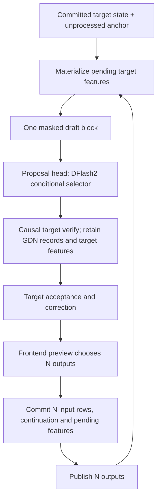

# DFlash and DFlash2

DFlash backends propose several tokens with one masked-block forward, conditioned on committed
target hidden features. The target verifies the proposal causally and remains the output authority.
Infernix implements DFlash and DFlash2 as optional components of the
[Qwen3.5 model](qwen3_5-model.md), and DFlash2 for Qwen3.8-Flash-Next (`Qwen4ExpForCausalLM`) and Inkling 2 Mini
(`Inkling2LoopForCausalLM`) as a companion artifact loaded beside the main one
([Qwen3.8-Flash-Next](#qwen38-flash-next), [Inkling 2 Mini](#inkling-2-mini)). Their
private config and bindings select the stored weights; startup chooses one backend, draft width
and proposal head.

This reference owns model mathematics, proposal distributions and backend state. Scheduling,
publication and common transactions are defined by [Engine architecture](engine-architecture.md).

## Configuration and current geometries

Both draft configs use `model_type=qwen3` and identify `DFlashDraftModel` or `DFlash2DraftModel`.
They supply draft layer count, attention/FFN dimensions, norm epsilon, one-dimensional RoPE theta,
layer attention types, sliding window, target block IDs and mask token ID. DFlash2 also supplies
convolution tap/group dimensions and selector rank/top-k. The hidden width and embedding/output
semantics come from the target. Exact fields are parsed in
[`config.cpp`](../../src/models/qwen3_5/config.cpp).

| Quantity | Official 35B-A3B DFlash | Official 27B DFlash2 | Flash-Next DFlash2 (incoai) | Inkling 2 Mini DFlash2 (incoai) |
|---|---:|---:|---:|---:|
| Hidden width H | 2048 | 5120 | 2560 | 2304 |
| Draft layers | 6 | 5 | 5 | 5 |
| Intermediate width | 6144 | 17408 | 7680 | 6912 |
| Q heads / KV heads / head dimension | 32 / 8 / 128 | 32 / 8 / 128 | 32 / 8 / 128 | 32 / 8 / 128 |
| Target block IDs | `[1,6,11,16,22,27,32,37]` | `[5,19,33,47,61]` | `[5,15,25,35,45]` | visits `[5,23,41]` and the final state |
| Attention pattern | Five local layers, then one full layer | Five local layers | Five local layers | Five local layers |
| Sliding-window scalar S | 4096 | 2048 | 2048 | 2048 |
| Norm epsilon / RoPE theta | `1e-6` / `1e7` | `1e-6` / `1e7` | `1e-6` / `1e4` | `1e-6` / `1e4` |
| Dynamic convolution | — | Two taps, group width 16 | Two taps, group width 16 | Two taps, group width 16 |
| Candidate selector | Per-position argmax | Top-16 conditional path, rank 256 | Top-16 conditional path, rank 256 | Top-16 conditional path, rank 256, softcap 30 after the correction |
| Training block (anchor + masks) | — | — | 8 | 8 |

The current Engine accepts startup draft count K in `1..15` and concurrency B in `1..8`. The
physical block width is `W=K+1`, containing one anchor and K masks. K is a runtime choice, not a
weight dimension. Geometry representable in config still needs the actual native Op support;
for example, DFlash2's fused convolution, context materializer and selector implement the listed
27B geometry.

## Target conditioning and context

Let F be the target's processed-token frontier. The target has consumed positions `[0,F)` and
already selected the next token `a=x_F`, which is the unprocessed anchor. Before proposing, the
backend materializes any committed pending target features so its context also reaches F.

For each processed position t, let `r_t^l` be the complete residual output of zero-based target
block l, after both mixer and FFN residual additions. Conditioning is:

```text
s_t = concat(r_t^l for l in target_layer_ids, in recorded order)
c_t = plain_rmsnorm(W_feature s_t, context_norm)
plain_rmsnorm(x,w) = w * x / sqrt(mean(x^2) + eps)
```

The feature projection is bias-free. A hidden-state API that counts the embedding as boundary zero
would expose block l at boundary l+1; the stored IDs are block IDs. Features are captured before
the next block's input norm or final Text norm. Multimodal inputs use the same target residual
capture after Vision embedding replacement.

Each draft layer independently projects this common c_t into its context K/V:

```text
k_raw^l(t) = W_context_key^l c_t
k_ctx^l(t) = rope_1d(plain_head_rmsnorm(k_raw^l(t), key_norm^l), position=t)
v_ctx^l(t) = W_context_value^l c_t
```

Context prefill performs feature projection and these K/V projections. It does not run prompt
tokens through the draft residual/MLP stack. Context uses absolute scalar Text cache positions and
full-head split-half RoPE; it does not use the target's partial three-axis MRoPE.

Source K/V parameters are used for both query-block and context projections. Their logical roles
and Uses remain separate; the official recipes share compatible physical data. The representation
of one role can be selected independently of the other.

DFlash2's fused context materializer stores BF16 K and `FP16_RNE(BF16(v_raw))` V. Raw K has no
observable BF16 cast between projection and head normalization. This complete contract is in
[`context_kv_materialize.h`](../../include/infernix/ops/context_kv_materialize.h). If a prefill chunk
exceeds the local ring capacity, only its final live window needs storage; the context frontier
still advances by the complete chunk.

The 27B's DFlash2, whose five layers are all local, extends that across chunks (2026-11-08, candidates
YE-01, after Ignis #506). A read of the ring at position F (the prompt end, where decoding starts, and
every snapshot the prompt may capture: its exact taps, its flexible taps at or after their position or
the last chunk's start, rewrite frontiers) needs only positions [F − S, F). Each text prefill pass
projects only its columns at or after the earliest such read after the pass begins, minus S; the
columns below it are overwritten in the ring before any read reaches them, so the ring is word for word
the same at every read. The lane keeps where its ring's contiguous run starts (`dflash_ring_from`): a
capture nothing planned (a coalescing sibling's tap, a lane that ends mid-prompt) whose ring is not
whole there is passed over, so every snapshot carries a whole ring. Prompts shorter than S between
reads project as before; Ignis measured the drafter's share of a 64K first token 220 → 75 ms (RTX
5090, NVFP4 27B, 2,048-token chunks).

## Query block and attention masks

The draft input is the target embedding of:

```text
absolute position   F       F+1       F+2       ...       F+K
input token         a       MASK      MASK                MASK
role                anchor  proposal  proposal            proposal
```

The anchor conditions the block but is not sampled from its draft output. Mask output i predicts
the token at the same absolute position, without the target causal LM's next-token shift. All
proposals come from this one forward.

Draft attention is non-causal over context and query-block K/V. For a local layer with scalar S:

```text
allowed(p_query, p_key) = abs(p_key - p_query) < S
```

Endpoints at distance S−1 are included; distance S is excluded. Populated sequence bounds clip
the symmetric interval. With a full left context and `p_query=F+i`, the row sees at most `S-1-i`
context positions, plus all W query rows for the supported widths. A full layer attends all
populated context and query rows. These masks are specified by
[`sliding_window_attention.h`](../../include/infernix/ops/sliding_window_attention.h) and
[`softmax_attention.h`](../../include/infernix/ops/softmax_attention.h).

## DFlash backbone and proposal

Each layer uses plain RMSNorm, full-head Q/K normalization and scalar RoPE:

```text
n = plain_rmsnorm(x, input_norm)
q = rope_1d(plain_head_rmsnorm(W_query n, query_norm), positions)
k = rope_1d(plain_head_rmsnorm(W_key n, key_norm), positions)
v = W_value n
a = attention(q, concat(K_ctx,k), concat(V_ctx,v), scale=1/sqrt(D), layer_mask)
y = x + W_output a
m = plain_rmsnorm(y, post_attention_norm)
x_next = y + W_down(SiLU(W_gate m) * (W_up m))
```

After final plain RMSNorm, the mask columns go through the selected proposal head. DFlash uses
per-column argmax, either over public vocabulary rows of the full Text head or over the indexed
proposal head followed by token-ID remapping. Thus its actual proposal q is a point mass, including
when target sampling uses positive temperature.

Changing W can change every proposal because attention is non-causal. A shorter block is not
required to match the prefix of a longer block.

## DFlash2 dynamic convolution

DFlash2 adds a dynamic grouped convolution around both attention and MLP. Each branch has input
and output sides, two taps and a group width of 16. For normalized branch input X, with
`X[b,i,g,j]`, `g=0..H/16-1`, `j=0..15`:

```text
delta = reshape(W_delta X, [B,W,2 sides,2 taps,H/16 groups])

Conv_s(X)[b,i,g,j]
  = (base[s,0,g,j] + delta[b,i,s,0,g]) * X[b,i,g,j]
  + 1{i>=1} * (base[s,1,g,j] + delta[b,i,s,1,g]) * X[b,i-1,g,j]
```

Base coefficients vary by channel; dynamic increments are shared by the 16 channels in a group.
Position zero has no preceding tap. The convolution has no history across requests or rounds.
The output side reuses the delta computed from that branch's normalized input, applying it to the
branch output rather than projecting delta again.

Each DFlash2 layer performs:

```text
n = plain_rmsnorm(x, input_norm)
(prepared_a, finish_delta_a) = attention_conv.prepare(n)
q, k, v = query_key_value(prepared_a)
q, k = plain_head_rmsnorm_and_rope(q, k, positions)
a = noncausal_attention(q, concat(K_ctx,k), concat(V_ctx,v), layer_mask)
y = x + attention_conv.finish(W_output a, finish_delta_a)

m = plain_rmsnorm(y, post_attention_norm)
(prepared_m, finish_delta_m) = mlp_conv.prepare(m)
z = W_down(SiLU(W_gate prepared_m) * (W_up prepared_m))
x_next = y + mlp_conv.finish(z, finish_delta_m)
```

The native fused prepare emits BF16 prepared input and BF16 finish delta. Internal normalized
input and projected coefficients are private intermediates; finish consumes the represented delta
from prepare. The contract is
[`dynamic_grouped_conv.h`](../../include/infernix/ops/dynamic_grouped_conv.h). After all layers, final
plain RMSNorm produces mask hidden columns for the selector.

## DFlash2 candidate path

For each mask hidden h_i, the selected head produces stable top-16 unary scores u_i and global
token IDs C_i. An indexed proposal head remaps shortlist rows before codebook access. Unary top-16
selection does not apply target penalties, temperature or top-k/top-p/min-p.

Qwen3.8-27B's full head (FP8 row, q8 or NVFP4, 248,320 x 5,120) is screened (since 2026-11-09, candidates RV-41;
the NVFP4 head of NVIDIA's NVFP4-QAD since 2026-11-27): at load
the engine fits a 2-bit copy of it (`ops::screened_head_fit`, 357.6 MB of VRAM, beside the KV cache's share), and a
round of at most 16 mask columns (one request's) takes its top 16 from `ops::screened_head_topk`: every row scored by
the copy, the rows near each column's best rescored exactly in FP32 and the 16 best kept. They are the full head's top
16 whenever the copy selects them; otherwise a lower row stands in for a missed one, which can only change which
drafts are proposed. On the reproducible route greedy output is unchanged (verification decides it); on the default
route, whose verification is not invariant to the draft width, changed drafts can change greedy text, as any change
of drafts can there. Sampled requests keep the target distribution (the drafts' own q is what the acceptance test
reads), though their tokens may differ. A column's
candidates depend on that column alone; on the reproducible route every row drafts alone, so each of its rounds takes
the screen and a request's drafts never depend on the batch. A batched round on the default route of 17-32 mask
columns (three or more requests drafting seven tokens, or two drafting more than eight) takes it in two calls of at
most 16 columns (since 2026-11-12, candidates ZK-07), which still read less than the full head's one: serving three
lanes, such a round's head took 559 against 894 us (-37 %, Nsight Systems kernel times). The drafts of those rounds
change from the full head's exact top 16 to the screened one's, as narrower rounds' already are. Wider rounds,
`--lm-head-draft`'s shortlist head and the lossless route keep `linear_topk`.

Measured (RTX 5090, 2026-11-09, `infernix_bench -p 512 -n 256 --spec dflash2 --draft-tokens auto`, INT8 KV, ABBA x3):
the screen and its top 16 take 264 + 39 us a round against `linear_topk`'s 757 us. On the reproducible route, where
both arms decode the same text, acceptance was identical and decode ran faster: official NVFP4 +2.9 %, NVIDIA NVFP4
+2.8 %, groupwise +3.7 %. On the default route the arms decode different texts (its verification is not invariant to
the draft width), so acceptance moved both ways: NVIDIA +7.2 % (acceptance 2.05 -> 2.12), groupwise +3.9 % (1.79
both), official -0.4 % (1.73 -> 1.66) for one prompt each. Greedy output on the reproducible route stayed identical
at ~150, ~2,000 and ~20,000-token prompts on all three, with acceptance equal in 7 of the 9 and 1.7-2.2 % lower in
two.

The NVFP4 head (NVIDIA's NVFP4-QAD, 715 MB: E2M1 codes, an E4M3 scale per 16 weights and the matrix multiplier) is
fitted and rescored from the same decoded values its A16 projection reads. Measured on QAD-Exact (RTX 5090,
2026-11-27, INT8 KV): cold op times (`infernix_linear_topk_bench`) at 7, 16 and 32 columns were 515, 742 and 1,137 us
for `linear_topk` over the full head, 240, 271 and 535 us screened (32 columns in two calls), and 218, 269 and 421 us
for `--lm-head-draft`'s Q4 proposal head. End to end (`infernix_decode_quality_gen`, `--draft-tokens auto
--ngram-draft-tokens auto`, one request, 24 code segments of 1,280 + 384 tokens and 24 thinking-on chats of 400
tokens), on the reproducible route, where every arm decoded the same greedy text and two passes agree within 0.4 %:
the screened full head against it unscreened +1.9 % on code and +1.8 % on chats, against `--lm-head-draft` +4.3 % and
+0.6 % (on code the screened arm proposed 12,263 drafts against 12,820 and had 7,424 accepted against 7,344). On
the default route, where the arms decode different texts (about +-3 % a cell), against `--lm-head-draft`: code +5.5,
+1.7 and +0.9 % at one, two and four requests, sampled docs +6.5, -2.5 and -1.4 %, chats +1.3 % (geometric mean
+1.7 %). Wider batched rounds (past 32 mask columns, more than four requests) were not measured: they take the full head's
`linear_topk`. Without `--lm-head-draft` the proposal head is not loaded, so the screen's 357.6 MB costs no KV against
it (314,688 tokens either way at two lanes). The recommended 27B setting still names `--lm-head-draft`.

Let predecessor/successor codebooks have shape `[vocab_size,R]` and the hidden projection have
shape `[R,H]`. The current selector receives its projected hidden g_i as BF16, candidate scores as
FP32 and codebooks as BF16. For predecessor candidate p and current candidate c:

```text
g_i = W_hidden h_i
pred_token(i,p) = anchor          if i=0
                  C_(i-1)[p]     otherwise
E_i[p,c] = u_i[c] + sum_r W_pred[pred_token(i,p),r] * g_i[r] * W_succ[C_i[c],r]
```

The path is a left-to-right conditional walk using the actual selected predecessor:

```text
temperature <= 0:
    j_i = lowest-rank argmax_c E_i[j_(i-1),c]
    q_i = one_hot(j_i)

temperature > 0:
    q_i[c] = softmax_c(E_i[j_(i-1),c] / temperature)
    j_i ~ q_i

d_(i+1) = C_i[j_i]
```

For i=0 every predecessor row refers to the anchor. This is a conditional walk, not global path
optimization. The Op retains the actual FP32 q_i and global candidate IDs for target correction.
It ignores other target sampling controls. The RNG key uses request seed, `F+i` and the distinct
DFlash2-proposal purpose; compact-batch row does not define random identity. Exact inputs,
tie-breaking and storage are in
[`candidate_selector.h`](../../include/infernix/ops/candidate_selector.h).

## Target verification and committed prefix

For each request, let P be the number of proposals that can be verified this round, `0<=P<=K`,
and Q=P+1 the target's live input width. The physical allocation still has W columns:

```text
verify input       a       d_1     d_2       ...       d_P
input position     F       F+1     F+2                 F+P
target output      p_0     p_1     p_2                 p_P
predicts position  F+1     F+2     F+3                 F+P+1
```

Proposal d_(i+1) is checked against target p_i. Target distributions include the public vocabulary
mask and configured penalties/temperature/filters, with accepted proposal history added as the
scan advances. Greedy verification accepts the matching target-argmax prefix. At the first
mismatch it emits the target correction; all-accept emits the bonus from p_P.

For positive-temperature target sampling, use the actual proposal distribution:

```text
accept d_(i+1) with probability min(1, p_i[d_(i+1)] / q_i[d_(i+1)])
on rejection: r_i(v) = max(p_i(v) - q_i(v), 0)
              correction ~ r_i / sum_v r_i(v)
on all accept: bonus ~ p_P
```

A proposal outside its 16 stored candidates (q = 0, never produced by a contract-conforming draw)
is always rejected, and its correction is drawn from p_i itself rather than from the residual: the
draft carries no proposal information. A tree sibling with Q = 0 is rejected the same way and
leaves the residual unchanged.

The `block-verification` fast-path candidate replaces the token rule on chain rounds with block
verification (Sun et al., arXiv 2403.10444; `ops::speculative_accept_sparse_drafts`): it accepts
the longest prefix whose block test passes, judged with the whole chain in view, and corrects
from the residual max(w p - q, 0) scaled by the prefix's acceptance weight w. The output
distribution is the same and the expected accepted length at least the token rule's; seeded
sampled text differs, and greedy rows, tree rows and Gumbel rows are unchanged. The accepted prefix
depends on every draft and every prefix test of the round, so neither may meet the next round,
which starts inside this round's drafts, again: the prefix tests draw with their own purpose and the
prefix length as sub-key, and the path's draft at step i with sub-key i (sampled MTP drafts already
carry their step). Until 2026-10-25 the path drew every step with sub-key 0, so a chained DFlash2
sampled run under block verification was biased (a replay of the keys over four-token laws moved the
most probable token's frequency from 0.600 to 0.573); its earlier A/B results ran on that form.

DFlash q is one-hot; DFlash2 q is the retained conditional distribution. This preserves the
processed target distribution for the verify path.

**Gumbel rows** (`SamplingConfig::gumbel_max`, the reproducible route's sampled requests) are verified by
equality with the target's own Gumbel-max draw, keyed by (seed, the produced token's position, token). Their
drafts are drawn with the same key (candidates ZH-01, after imp #3095): the path's draft i takes the candidate
maximizing log q + g(seed, base + i + 1, token), and a tree node's children are its law's Gumbel top ranks in
that order, so a draft is the target's draw whenever the target's draw is also the drafter's own Gumbel winner
among its 16 candidates. A Gumbel-max pick is an exact draw from q, so the drafts' distribution and q are those of
the proposal-uniform draw; only which draw is taken changes, and the output is plain sampling's text either way
(the route's contract). MTP's argmax drafts do the same at a round's leading steps (candidates QK-04,
`ops::speculative_couple_drafts`): every step on a dense model and the first on a mixture of experts
(ExecutionSchedule::coupled_mtp_steps). The gain sits at the leading positions while each coupled step costs about
20 us: against no coupling the NVFP4 27B gained 4.45 / 7.76 / 8.9 % with one, two or all five steps coupled and the
35B-A3B 1.08 / 0.33 / -0.13 % with one, two or all three; the 122B follows the 35B until it is timed. Such a draft is re-drawn from the head's logits as the support sample() builds under the row's temperature,
top-k, top-p and min-p (no penalties or masks) with the Gumbel key of its verify column, the head's probability of
the drawn row then feeding MTP's confidence policy; greedy rows and the prompt's first MTP drafts keep the argmax.
DFlash's argmax chain drafts are not coupled: on the only configuration that runs them (35B-A3B `--spec dflash`)
coupling cost 0.12 % of sampled decode and moved acceptance by 0.3 %. With
`--draft-tree-nodes` a DFlash2 round
instead verifies a tree of proposals built from the same lattice, whose main chain is this path
([tree verification](tree-verification.md)). Different draft formats, shortlist heads or
block widths can change acceptance and throughput; their logits need not match one another.

### Live widths

The two backend implementations use different proposal extents near a request tail:

| Extent | DFlash | DFlash2 |
|---|---|---|
| Proposal attention/masked input | Q=P+1 live columns | All W=K+1 columns |
| Target attention and GDN | Q=P+1 live columns | Q=P+1 live columns |
| Candidate prefix checked | First P proposals | First P proposals with their actual q |

DFlash2 computes its configured W-column proposal even when only a prefix can be verified. Its
proposal-valid tensor and target-valid tensor have different meanings. Columns outside the
target live extent have no logical state effect. P=0 verifies only the anchor and selects a target
output.

### Publication and state alignment

If A proposals are accepted, target verification licenses
`y=[d_1,...,d_A,correction_or_bonus]`, with L=A+1 outputs. Frontend preview chooses the final prefix
length N, `0<=N<=L`, accounting for EOS, stop, budget and cancellation.

When N>0, the transaction commits N target input rows `[a,d_1,...,d_(N-1)]` and publishes N output
tokens `[y_1,...,y_N]`. Continuation hidden comes from verify column N−1, and y_N becomes the next
unprocessed anchor. Target KV, GDN Fold, generated-token counters and frontier advance together.
The Fold uses records from this physical verify block, not a separately recomputed numerical path.

The first N columns of captured target features become pending context work. Context may remain at
F while target state advances to F+N. Before the next proposal, or before retaining a checkpoint,
fork or Host replica, those features are materialized and context catches up. N=0 cancellation
commits no new state and releases the sequence; it does not undo earlier adopted commits.

## Backend storage and lifecycle

Local draft layers store K/V in cyclic rings; full draft layers use paged KV. A full pool exists
only when selected draft config has full-attention layers. The official DFlash2 instance therefore
has five local rings and no full draft pool. Its ring payload per state image is:

```text
5 layers * (2-byte K + 2-byte V) * 8 heads * 128 * 2048 = 40 MiB
```

For frontier F_ctx and ring capacity S, the live interval is `[max(0,F_ctx-S),F_ctx)`, and absolute
position p uses physical slot `p mod S`. Frontier and coverage are sequence metadata. Old bytes
outside the live interval are unreachable.

Query-block K/V, candidate paths, q, verify results and GDN records are round scratch. Pending
features survive commit until context catch-up, but are not checkpoint payload. Increasing K
expands these transient extents; it does not increase DFlash2's 40 MiB ring image or introduce
cross-round convolution history.

Device fork, prefix-cache snapshots, their Host copies and restore carry the backend context
together with target state and continuation metadata. Their coverage must agree. These rules are
shared with the [hybrid prefix cache](hybrid-prefix-cache-spec.md),
[resource scheduling](resource-scheduling-and-context-cache.md) and [ReplaySSM](replayssm-gdn.md).

## Qwen3.8-Flash-Next

The Flash-Next drafter ([incoai/Qwen3.8-Flash-Next-DFlash2](https://huggingface.co/incoai/Qwen3.8-Flash-Next-DFlash2))
has the 27B drafter's mathematics at the geometry above; the fused Ops register both geometries
(hidden 5120 and 2560, RoPE theta any value through the prepared tables).

- **Companion artifact.** `tools.convert --components dflash2 --recipe qwen3_8_flash_next_dflash2`
  writes the drafter alone ([weight conversion](../weight-conversion.md)): no text component, its
  `dflash2` component targets the main artifact's text, and its Uses name the target heads it reads
  ([container §4.3](artifact-container.md#43-companion-artifacts)). `--spec dflash2 --draft-model
  FILE` loads it beside any Flash-Next artifact; the loader checks its `target_config`, binds its
  parameters after the main artifact's and materializes it in its own allocation
  ([`load.cpp`](../../src/models/qwen4_exp/load.cpp)). The drafter embeds with the main artifact's
  token embedding (BF16, or a GGUF import's IQ4_XS rows decoded exactly) and reads the text head
  (fused `linear_topk` for a Q8 head, else FP32 logits and `top_logprobs`) or, with
  `--lm-head-draft`, the proposal head (fused `linear_topk` for the 131,072-row Q4 head).
- **Features.** The target's feature of block l is the mean of the four hyper-connection streams of
  its completed residual (`ops::hyper_connection_stream_mean`), as the drafter was trained; the five
  taps form `s_t` (12,800 values). A decode or verification round captures every column, a prefill
  call or forced tokens their last S columns, and a layer walk its span's last S columns, layer by
  layer ([`forward.cpp`](../../src/models/qwen4_exp/execution/forward.cpp),
  [`prefill_walk.cpp`](../../src/models/qwen4_exp/program/prefill_walk.cpp)).
- **Context ring.** Each lane has five cyclic rings (BF16 K, FP16 V, 2,048 slots, 40 MiB). A prefill
  call, forced tokens or a walk span write their last window's context eagerly; a round's commit
  writes the committed columns' (one CUDA Graph per batch size and width). The ring is part of the
  prefix cache's state image (the drafter group), with its frontier in the image header; a tap
  inside a layer walk copies the ring as it stood before the span, which only costs acceptance after
  a resume from it.
- **Rounds.** One-row rounds speculate; two-row rounds only with the `dflash2-pairs` fast path (on by
  default on every configuration and KV format by the owner's decision of 2026-10-24, ahead of its quality
  gate, which has not run: Dense8, two requests, INT8 KV, decode +28 % median;
  [model quality §6.7](model-quality.md#67-fast-path-registry); `adaptive-speculation` is MTP's), whose rounds
  of two rows share one proposal and verify one width of at most two drafts per row (2 x 3 columns,
  inside the column-invariant routes; three drafts reach 8 columns, which cost MTP pair rounds 3.1
  plain rounds). With `--draft-tokens auto` the width is the k maximizing (both rows' expected tokens
  with their first k drafts verified) / (1 + 0.1 + 0.47 k) plain two-row rounds, each row's expected
  tokens from its calibrated drafts as below (a copy row's from its bucket's acceptance; a copy is
  verified whole), one draft more every 8 pair rounds; a row with fewer drafts is padded with filler
  columns that cost as much, so both rows verify every draft up to the width
  ([`draft_length.h`](../../src/runtime/speculative/draft_length.h) `pair_draft_width`). The costs are
  priors (MTP pair rounds' measured draft cost, one row's proposal share), not yet measured on
  DFlash2 pairs. Rounds of three or more rows decode plain. The drafter always proposes its configured block of K + 1
  columns (one CUDA Graph per batch size) and the round verifies a prefix of its drafts. K is at
  most 7, the block the drafter was trained with and the widest column-invariant verification.
- **Draft length.** The selector also writes each draft's temperature-1 probability at its
  selected rank (`candidate_selector_path`'s optional `confidence`), read back with the drafts.
  A fixed `--draft-tokens N` verifies all N, or with `--spec-min-p P` those before the first below
  P. `--draft-tokens auto` verifies the k maximizing (1 + sum of products of the drafts'
  calibrated acceptances) / (1 + 0.1 + 0.31 k) plain rounds, each draft's acceptance read from its
  probability's decile and learned per request, one draft more every 8 rounds
  ([`draft_length.h`](../../src/runtime/speculative/draft_length.h)). Measured on the 5090
  (Dense8 and IQ3_S, 2026-10-20): verifying all seven was 18-24 % slower than MTP `auto`, a fixed
  cut at 0.6 3-15 % faster, the calibrated length 8-11 % faster on code, docs and sampled docs
  (26 % on sampled code; the means of every run, Dense8 code from four runs against eight);
  the same policy with the online round-cost fit of MTP's chose shorter lengths and was 6 % slower
  on code. A round with a sampled row
  verifies by sparse rejection sampling with the selector's laws (one-hot for its greedy rows and
  at an n-gram row's copies); a round of greedy rows, whose drafts are deterministic, takes the
  greedy acceptance. Greedy output equals plain decoding either way.
- **Implementation.** [`execution/dflash2.cpp`](../../src/models/qwen4_exp/execution/dflash2.cpp)
  (the drafter's Op sequence, no state) and
  [`program/dflash2_program.cpp`](../../src/models/qwen4_exp/program/dflash2_program.cpp) (ring,
  features, io, graphs).

## Inkling 2 Mini

The Inkling 2 drafter ([incoai/Inkling-2-Mini-DFlash2](https://huggingface.co/incoai/Inkling-2-Mini-DFlash2)) is the
same mathematics at Inkling 2 Mini's widths, with three differences: its features are DSpark's (the inputs of layer
visits 5, 23 and 41 and the final-normed state, concatenated: no stream mean), its block's inputs are the target's
normed embeddings, and its selector applies a softcap of 30 to each edge after adding the correction
(`selector_softcap_mode` `after_correction`; `candidate_selector_path`'s `edge_softcap`). `tools.convert --components
dflash2 --recipe inkling2_mini_dflash2_nvfp4_mlp` writes the recommended companion (the MLP NVFP4, below, the other
projections Q8 as Flash-Next's; the codebooks cut to the real 200,058-token vocabulary), `--recipe
inkling2_mini_dflash2` an all-Q8 one; `--spec dflash2 --draft-model FILE` loads it beside any Inkling 2 artifact, and DSpark
is then not bound. Its context ring holds committed positions only (a verify call's committed columns are written at
its round's commit). The rounds are Inkling 2's ([design §13.8](inkling2_mini-design.md#138-the-dflash2-companion---spec-dflash2---draft-model)):
a draft is kept only when it equals the target's own draw, so speculation never changes the output.

Since verification is equality with the target's draw, a whole-vocabulary sampled row's drafts (`full_vocabulary`,
`top_k 0`) can be coupled with the draws themselves (`candidate_selector_path`'s `couple_draws`, which Inkling's
drafter passes): draft i is the candidate maximizing edge/T + the Gumbel noise sample() gives that token at verify
column i (keyed at the produced position, `sampling_full_noise`). It is an exact draw from q, so q and the drafts' law
are unchanged; the draft is the target's draw wherever the two laws agree at that noise, instead of only when the
target draws the drafter's argmax. At 7 drafts a round and temperature 1 (the real test's four prompts, 256 tokens
each, the same tokens either way) it raised the tokens a round from 3.14 to 3.48. The default top-20 rows keep greedy
drafts: coupling them by sample()'s inverse-CDF uniform over the candidates in descending order of q lowered the tokens
a round from 3.49 to 3.33 there, likely because a rank is shared only up to the smaller of the two laws' probabilities
(a drafter less confident than the target at its likeliest token gives up the target's own draw there). Served (one request, short prompts, 512 tokens,
`--lm-head-draft`, two runs each), the coupled whole-vocabulary drafts decoded at 341.3 tok/s against the greedy
drafts' 324.3 (+5.3 %; the two arms' top-20 and greedy phases, identical in what they draft, differed by 0.1-0.3 %).

The recommended companion's MLP is NVFP4 (recipe `inkling2_mini_dflash2_nvfp4_mlp`, 16-bit activations; the all-Q8
`inkling2_mini_dflash2` is the other recipe): the gate/up runs as
the NVFP4 linear ([13824, 2304]) then `silu_mul` over its two halves, and the down through
`linear_dynamic_grouped_conv_add`'s NVFP4 route, the NVFP4 linear ([2304, 6912]) into the projected matrix then the Q8
route's finish. Their sliced-K schedules take at most 4 K-warps (a block K of 256: 2304 and 6912 are no multiples of
512), and widths to 8 take the 8-token tile (the 1-2 column GEMV and SIMT schedules read K in phases of 512). At 8
columns NVFP4 A16 against Q8 A16 on a shape both register ([5120, 6144], linear_bench) took 17.0 against 23.1 us,
23.1 against 25.0 at 16 and 64.1 against 66.1 at 64; at Inkling's shapes (other benches: SwiGLU fused for Q8, the
NVFP4 linear without silu_mul) 17.0 us against 23.7 for the gate/up and 12.9 against 19.6 (with its finish) for the
down at 8 columns, about even at 32-64. Served before the cheaper rounds below (2026-11-26, draft 0.761 against
0.785 ms) it ran 0.5-0.9 % faster than the Q8 companion one request at a time on short prompts, level on long ones,
within the spread at four and eight short requests and 4.1 % faster with four questions on a 122K-token prefix, with
the same acceptance on short prompts (0.9 % lower on long ones) but 1.4-2.0 % fewer tokens a round at a fixed 7
drafts. After them (2026-11-27, `main` at `313d35ff2`) the agentic replay (three seeds, each companion first in some)
took the same wall time with either (-0.08 % with NVFP4-MLP: -0.21, -0.07 and +0.04 % by seed), and the sweep
(alternating runs, two each, draft 0.685-0.696 against 0.709-0.712 ms) had it 0.9 % slower on eight short prompts one
at a time and 1.8 % slower with four at once (both beyond the runs' spread; it accepted 2,357 drafts there against
2,373), 0.6 % faster with four questions on a ~30K-token prefix and level on the 122K-token prefix and with eight at
once. The NVFP4-MLP recipe is the recommended one, chosen by that replay's wall time (a tie) and for its size (515
against 635 MB) and KV pool (554,560 against 547,456 tokens at eight lanes); the real test's CPU oracle decodes only
BF16 and Q8 weights, so it runs on that companion with `INFERNIX_INKLING2_DFLASH2_ENGINE_ONLY`. The attention output (9.4 M
parameters a layer against the MLP's 47.8 M) and the feature projection (21 M, once a round) would save about a fifth
and a tenth of the MLP's 0.024 ms more; q/k/v and the context projections stay Q8 either way
(`attn_input_proj`'s drafter form and `context_kv_materialize` read Q8).

Four changes made a DFlash2 round cheaper (2026-11-27, from an nsys profile of the round: draft 583 us of device time
one request at a time, the commit context 50 us). The commit context (the gather of a verify call's accepted columns
and their materialization into the rings) is captured as one CUDA graph per row count beside the draft graphs, with
its words staged in pinned memory (eager without CUDA graphs); the drafts it leads to are unchanged (the same accepted
and drafted counts one request at a time). Its graphs (one per row count, up to eight) raise the startup's graph
allowance by 24 MiB, 1,536 tokens of the KV pool (547,456 against 548,992 at eight lanes). The ten conv prepares a draft run Flash-Next's fused prepare kernel, at
H 2304 with 6 warps a CTA and up to 16 columns a chunk (6.75 against 12.9 us at block 8 and one to four rows, 8.8
against 12.9-14.9 at five to eight). The feature projection ([2304, 9216]) has its own Q8 shape with Flash-Next's
sliced-K schedule (8 columns 17.5-18.9 against 27.2 us, 16: 21.1-21.6 against 89.2, 32: 31.4 against 90.6, 64: 49.8
against 88.7). `logits_topk` takes a group's top sixteen with one warp a 512-row group and column (sixteen warp-wide
maxima over 16 keys a lane) instead of a 128-row sort, the same candidates by construction (it was 15.9 us at one
row's 7 columns, 33.7 at four rows'; at Qwen3.8-Flash-Next's full 248,320-row head, which a text head without a
fused selection also drafts from, 11.0-11.1 against 40.1-41.2 us at 7 columns and 42.9-44.3 against 282-285 at 56).
Served (one request at a time eight short prompts, then four questions on a ~30K-token and on a 122K-token prefix,
then four short requests at once; alternating runs, two each, the same texts), the draft's device time fell from
0.674-0.679 to 0.586-0.587 ms and output tok/s by wall rose 1.6 % on the short prompts (the only phase beyond the
runs' spread), 0.6 % on the ~30K-token prefix, 0.5 % on the 122K-token prefix and 3.6 % with four requests at once
(within the spread: 551.5-589.0 against 584.0-596.9).
The new kernels change the drafter's bits (2,373 against 2,364 accepted drafts on the short prompts), not the output.
The attention output and MLP down projections run 144 CTAs on 170 SMs (16 output rows each); 16 K-warps and
double-buffered stages for them measured slower and level, and a split-K across CTAs (about 50 us a draft at most)
was not built.

The draft length (`--draft-tokens auto`) is `calibrated_draft_length` over the request's deciles, with one-row costs
in plain one-row rounds that follow the request's context (`kDFlash2ContextCosts`, linear in log2 of the context
between anchors, the end anchors beyond them): to 4,096 tokens 0.12 a verified draft and 0.16 for the proposal; at
25,856 tokens a verify call's fixed 0.203 beyond a plain round, 0.129 a draft and 0.098 the proposal; at 122,486
tokens 0.183, 0.156 and 0.071. The two long anchors are fitted (2026-11-27, on the cheaper rounds above) to wall round
times at fixed lengths 1-7 against plain rounds there, one request at a time. Rounds of several rows take their width
from the device times they measure. With the fixed costs everywhere (2026-11-26, wall tok/s over eight short prompts
one at a time, four questions on a 122K-token prefix one at a time, and four short requests at once), auto beat every
fixed length from 3 to 7 one request at a time by 5-8 % (the best fixed lengths 4 and 3) and tied fixed 3 at four
requests. Against the fixed costs everywhere (2026-11-27, alternating runs, three each), the context's costs decoded
0.7 % faster on the 122K-token prefix (every run above the fixed costs' runs, by 0.05 tok/s at the closest), 0.1 %
with four questions on a ~30K-token prefix and 3.0 % with four short requests at once (both within the spread); short
prompts run the same rounds. Between 4,096 and 25,856 tokens the interpolated costs were not measured on their own:
in the agentic replay DFlash2's requests of 8K-32K decoded as before (131.5 tok/s both times) while the longer ones
gained 1.1-1.2 %. Three other one-row costs were measured and not kept, each faster in some phases and
slower beyond the runs' spread in another (alternating runs, two each):

| One-row costs | 8 short prompts | 8 prompts, `top_k 0` | 122K-token prefix | 4 requests at once |
|---|---|---|---|---|
| Fitted to the round times at fixed 1-7 drafts (short context): 1.351 + 0.107 a draft, of which 0.129 the proposal | +0.9 % | +1.1 % | -1.4 % | +1.1 % (within the spread) |
| The device times each context bucket measures (the proposal and the verify call at each width) | -5.2 % | -0.9 % | +1.2 % | +3.2 % |
| Fitted by context, the short anchor too (at ~270 tokens 0.215 + 0.106 a draft, 0.107 the proposal) | +0.1 % | not run | +0.9 % | -2.0 % |

The short-context fits are a short context's: at 122K a verified draft costs 0.156 plain rounds there against 0.106
(each verify column attends over the whole context), so they under-cost a draft and the rounds verify too many
(acceptance 0.46 against 0.49). The device times leave out what a draft costs the host (its commit, the read-back), so
the rounds verified too many drafts on short prompts (35 % accepted against 48 %). The short anchor's fit verified
more drafts on the eight short prompts (5,090 against 4,952) for no more accepted (2,370 against 2,373): level one
request at a time, slower with four at once.

## Execution flow



### Automatic verify width (Qwen3.8-27B / Qwen3.6-35B-A3B)

With `--draft-tokens auto` and the `adaptive-dflash` fast path, an all-neural chain round (no
n-gram copy, no tree) splits its Forward graph in two:

1. A proposal graph per batch size and drafter profile appends the pending context and drafts the
   whole block of K drafts (the ceiling unless given: the 27B's DFlash2 15, the 35B-A3B's DFlash
   7) into a block region of the round frame, with each draft's probability under the drafter:
   DFlash2 the candidate selector's temperature-1 softmax at the drafted rank
   (`candidate_selector_path`'s confidence), DFlash the head's log-probability at its argmax
   (`target_logprobs` on the proposal logits). Drafts and probabilities reach the host with one
   event.
2. The host picks the round's width W among the captured widths (one row: 2-8, 10, 12, 14, 16;
   several rows: 2, 4, 8, 16; each up to K + 1), maximizing the rows' expected tokens per round
   time: each row's expected tokens follow from its drafts' probabilities through its request's
   calibration ([`draft_length.h`](../../src/runtime/speculative/draft_length.h), the deciles of
   Qwen3.8-Flash-Next's policy), and a round of B rows costs
   1 + proposal + B (per_draft min(W - 1, knee) + per_draft_wide max(W - 1 - knee, 0)) plain rounds
   of its batch size, with the configuration's measured costs (`dflash_width_costs`). Every eighth
   choice of a row runs the next wider width. The policy is
   [`dflash_width_policy.h`](../../src/models/qwen3_5/program/speculative/dflash_width_policy.h).
3. A verify graph of that width copies each row's leading min(W - 1, limit) drafts (and DFlash2's
   laws) from the block into the round's frame and runs target verification; the round's Finish
   accepts as usual.

Each width is a split round family (one verify executable per batch size: target verification has
no context-dependent topology) and its Finish; the proposal graphs keep the drafter's profiles.
Because the choice reads the round's own proposal and never the target's draws, acceptance and
sampling stay exact for any width; only the verification width varies, which is why the policy is
a fast path.

A configuration with a batch length (`dflash_batch_drafts`: the NVFP4 27B's 7) runs its rounds of
several rows without the split: one plain neural family of that length, serving batch sizes 2 and
up, drafts and verifies it in one graph, since the block proposal and the host wait cost a batched
round more than any width saves there. The policy then chooses for one row only, and the proposal
graphs serve one row. A copy round's batched rows without a copy propose the batch length too, and
a copy replaces the neural proposal of a batch when it offers more drafts than that length (of one
row, more than the block); the narrower copy families lie above the lower of the two. Rounds with
a copy proposal keep their families. Automatic DFlash2 trees (`--draft-tree-nodes auto`) resolve to
chains beside the policy: trees of K + 5 and K + 9 columns on the 15-draft block verified slower
than its chains, and the tree controller would time the chain only when the policy verifies the
whole block; a fixed tree table still runs. The 35B-A3B (no batch length) chooses its batched
widths too. Where the path does not run (the groupwise 27B, `--reproducible`), `auto` verifies the
configuration's fastest single fixed length every round (`auto_fixed_draft_tokens`: 7 on the 27B,
3 on the 35B-A3B). Measurements and the registration are in
[model quality 6.7](model-quality.md#67-fast-path-registry).

The finite model implementation is in
[`execution/draft.cpp`](../../src/models/qwen3_5/execution/draft.cpp); storage is in
[`program/storage/draft_context.cpp`](../../src/models/qwen3_5/program/storage/draft_context.cpp).
Workspace planners and CUDA Graph profiles use the selected parameters and startup widths. Native
Ops retain their own format, shape, numerical and state-transition contracts.
